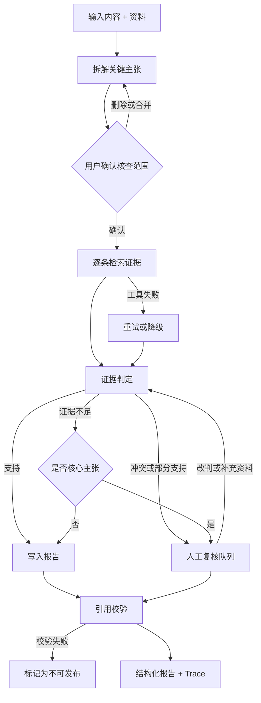

# 01 场景定义

## 一句话定位

内容证据核查 Agent 帮内容运营人员判断一段消费决策类内容里的关键说法是否站得住脚，并给出可回溯到原文和来源的核查报告。

## 背景与痛点

社区里大量高传播内容是消费决策类内容：测评、种草、对比、避坑。这类内容的问题不在于观点好不好，而在于里面混进了无法核实的事实性说法，例如"续航 20 小时""全系支持无线充电""某机构认证""90% 用户 4 周改善"。其中一部分是表述夸大，一部分是限定条件被省略，一部分是引用了过期资料。

现在运营人员面对这些内容，主要靠三种办法：

| 现有办法 | 不足 |
|---|---|
| 人工翻资料逐条核对 | 慢，且不同人标准不一致，无法沉淀 |
| 用通用搜索或聊天工具问一句 | 得到的是一段结论，无法知道它读了哪些资料、哪句话对应哪条证据 |
| 依赖审核规则与关键词 | 只能命中固定词，识别不了"数据真实但条件被省略"的情况 |

核心痛点是：**缺少一条能在保留证据链的前提下，把批量内容核查标准化、并把不确定的部分明确交回给人的流程。**

## 目标用户

主用户是内容运营／社区治理人员，日常要处理一定量的消费决策类内容，需要在有限时间内判断哪些内容需要干预，哪些只是观点表达。

次要用户是内容创作者本人，在发布前自查自己的表述是否存在条件省略或引用过期资料的问题。

在作品集语境里还有第三类用户：面试官。他会用 5 分钟判断这个项目有没有真实产品判断。所以界面必须让"哪一步做了判断、为什么这样判断、失败时怎么办"在首屏可见。

## 用户任务

用户要完成的不是"问一个 AI 问题"，而是三件事：

1. 从一段内容里确认哪些说法需要核查
2. 看到每条说法的判断依据，并处理冲突或证据不足的条目
3. 拿到一份可以交付、可以复核、可以追溯的报告

## 与现有方案的差异

| 方案 | 覆盖的部分 | 缺口 |
|---|---|---|
| 通用聊天助手 | 快速给出结论 | 无证据定位，无失败可见性 |
| Deep Research 类产品 | 能检索并生成带引用的长报告 | 报告级输出，无法按单条主张复核；引用常只到文档级 |
| 审核规则引擎 | 稳定、可规模化 | 只处理可枚举的风险，无法处理事实性核查 |
| 本项目 | 主张级判定 + 证据定位 + 人工复核队列 + 版本回归 | 不做内容发布、不做账号处置、不做大规模线上流量 |

差异点不在"用了 Agent"，而在于**把判定粒度从整篇内容下沉到单条主张，并明确了哪些情况必须交回给人**。

## 产品边界

本期不做：内容发布与账号处置、多租户与权限体系、通用 Agent 创建平台、模型训练与微调、实时爬虫、大规模并发调度。

## 核心流程

## 两个人工介入点

**第一个：确认核查范围。** 拆解出来的主张有多有少，有些是营销修辞，有些用户根本不关心。这一步让人删掉无关主张，避免后续浪费检索和判定成本，也避免报告被无关条目淹没。

**第二个：处理冲突与不确定项。** 资料互相矛盾、限定条件被省略、认证过期这类情况，机器可以识别但不能替用户决定怎么处置。系统只负责把证据并排摆出来并给出建议，最终判断留给人。

除了这两处，流程中不再插入确认，否则会把 Agent 变成需要人盯着点的表单。

## 成功定义

第一阶段只证明一件事：**在人工标注的 30 条任务上，系统能否在证据不足时稳定地说"我判断不了"，而不是硬给结论。**

这件事成立之后，第二阶段再看效率：人工复核一条主张需要多久，改判率有多高。

## 指标口径

任务质量：

| 指标 | 计算方式 |
|---|---|
| 主张识别召回率 | 命中的标注主张数 ÷ 标注主张总数 |
| 主张识别过度拆分率 | 被拆成多条但实际为同一主张的数量 ÷ 生成主张总数 |
| 主判定准确率 | 支持／部分支持／冲突／证据不足 四分类一致率 |
| 标志位召回率 | 过期、资料冲突、范围错配等标志的召回 |
| 无依据确定性结论率 | **已给出判定**的证据不足主张中，被判为支持或冲突的比例；没拆出来的、没给 verdict 字段的分别单列，不进分母，**这是核心指标** |
| 引用有效率 | 引用来源确实支撑该结论的比例 |
| 复核队列命中率 | 应进队列的主张中实际进入的比例 |

系统效率：

| 指标 | 计算方式 |
|---|---|
| 单任务延迟 | 从提交到报告生成的耗时 |
| 单任务成本 | 每次运行的 token 花费，按模型单价折算 |
| 重试率与失败率 | 工具调用失败后成功恢复的比例 |

用户行为（Demo 阶段的埋点）：

| 指标 | 说明 |
|---|---|
| Time to First Successful Run | 首次完整跑通任务所需时间 |
| claim_edited_ratio | 用户删改主张的比例，衡量拆解质量 |
| trace_step_expanded | 用户展开了哪一步的 Trace |
| review_decision | 复核时采纳还是改判，衡量判定可信度 |
| run_abandoned | 在哪一步放弃，衡量流程阻塞点 |
| report_exported | 是否导出报告，衡量交付价值 |

## 模型与评测口径

默认模型 DeepSeek Flash，模型 id `deepseek-flash`，接口地址 `https://api.deepseek.com`。具体接入时需要在配置中固定模型 id、温度和最大步数，并写入每次运行记录。

评测纪律：

- 比较两个 Prompt 版本或工作流版本时，模型必须固定，否则无法区分是 Prompt 的功劳还是模型的功劳。
- 换模型单独作为一条对比轴，报告里必须标明所用模型 id。
- 每条任务的运行结果保留原始输出，人工评分基于原始输出，不基于修改后的结果。
- 温度默认为 0，需要采样多样性时单独记录。

## 非目标

不做通用 Agent 平台，不做内容发布与处置，不做实时爬虫，不做多用户权限，不做模型训练。所有平台能力都挂在"内容证据核查"这一个任务上，用不到的能力本期一律不做。
