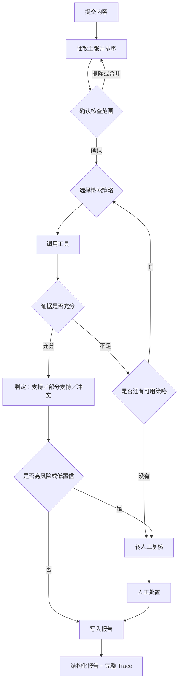

# 10 PRD：自主检索型内容核查 Agent（v3）

> 状态：v1.0（已由场景验证修订）　|　日期：2026-10-04　|　负责人：（待填）
> 关联文档：`01-scenario-definition.md`（场景与指标）、`02-labeling-rules.md`（标注规则）、`04-harness.md`（评测口径）、`08-pipeline-comparison.md`（v1/v2 对比）、`09-web-interface.md`（现有界面）、`11-scenario-validation.md`（场景验证，本文档 1.3／1.5／2.3／4.3／6.2／11 节依据它修订）

## 0. 这份 PRD 要决定什么

一句话：**把"资料由人给、顺序写死"的两段式工作流，升级成"自己决定查什么、查到什么程度算够、查不到就交回给人"的 Agent，并用同一套评测证明这次升级值得。**

需要这份文档拍板的只有四件事：

1. **自主范围到哪里为止**——哪些决定交给模型，哪些必须写死在代码里。
2. **工具层的边界**——提供哪几个工具、失败怎么降级、单条主张允许花多少钱。
3. **用什么数据判断 v3 比 v2 好**——任务集怎么扩、新增哪些指标、控制哪些变量。
4. **判断结果的下游到哪为止**——产品输出到"建议"还是"处置"，见 4.3。

## 1. 背景与问题

### 1.1 现状

现有 v2 管线是固定两段式：先抽取主张，再对每条主张做一次独立判定调用。资料（`sources`）由任务集或用户直接提供，随 Prompt 一起注入。

它已经解决了"判定粒度"问题——判定单位从整篇内容下沉到单条主张，并明确了哪些情况必须交回给人。但在产品形态上，它仍然是一个**工作流**：顺序固定、证据来源固定、没有决策环。

### 1.2 三个具体缺口

| 缺口 | 具体表现 | 后果 |
|---|---|---|
| 证据来源被限定在人给的资料里 | 用户必须在提交前自己找齐资料 | 找资料的成本没有下降，产品只是把"判断"这一步自动化了 |
| 资料里没有答案时没有出路 | 只能输出 INSUFFICIENT，不会换查询、换来源 | 大量本可判定的主张停在"证据不足"，复核队列被灌满 |
| 没有工具调用与决策记录 | Trace 里只有模型调用，没有工具调用 | Agent Infra 岗位要求的 Tool Registry 与 Agent Runtime 在项目里没有对应物 |

第三条是这次升级最直接的理由：**v3 的价值不只是效果更好，而是让"平台能力"第一次在项目里真实存在。**

### 1.3 问题陈述

> 内容运营以**内容条**为单位处理大量内容，节奏是高速、批量、按规则判断；其中一部分内容含有无法核实的事实性说法。他们需要的不是"帮我判断每条说法的真假"，而是"**这条内容里哪些说法需要进一步核实、依据是什么、判不了的交给了谁**"。

这个表述是被 `11-scenario-validation.md` 修正过的。原先把"运营需要逐条核查主张"当作既定前提，但公开证据指向的是另一幅图景：主张级查证出现在专门的事实查证团队（腾讯较真），而运营侧的公开证据全部是条级、高速、按规则表判断。

因此本项目的定位是：**以内容条为单位做分诊，以主张为单位做证据链。** 主张级判定是手段，不是用户任务。

### 1.4 为什么不是继续改 Prompt

Prompt 优化的收益已经在 v1→v2 的对比里释放过一次（两段式优于单次调用）。剩余失败案例集中在**信息不在上下文里**这一类，属于检索能力问题，不是表达能力问题。继续调 Prompt 无法触及，只会让指标在小数点后波动。

### 1.5 竞品与差异化

此前文档中"面向平台运营的主张级核查产品没有明确对标"的判断是错的。腾讯较真 AI（2025-08 上线）已经把"结论-过程-评估 + 多源证据比对 + 可信度评分"产品化，背后是 10 年查证积累、百万级辟谣数据库与专家库。

| 维度 | 腾讯较真 AI | 本项目 |
|---|---|---|
| 目标用户 | 普通用户（公众） | 平台内运营与治理人员 |
| 工作单位 | 单条说法，用户逐次提问 | 批量内容，逐条内容分诊 |
| 交付物 | 给用户看的查证结论 | 复核依据包 + 建议动作 + 处置记录 |
| 是否被评测 | 是产品能力，不是被评测对象 | 自己就是评测对象，有任务集与版本对比 |
| 平台能力 | 不对外暴露 | Tool Registry、Trace、版本回归 |

**诚实的判断**：在"查得准"这件事上本项目不可能超过较真。本项目唯一站得住的差异点是"面向站内的批量分诊 + 可评测迭代 + 平台化"。任何演示与简历表述都必须落在这三点上，不能暗示本项目是一个更强的查证产品。

## 2. 目标与非目标

### 2.1 目标（每条都可验证）

| 编号 | 目标 | 验证方式 |
|---|---|---|
| G1 | Agent 能自主决定每条主张用什么工具 | 新增 `tool_selection_accuracy`，以人工标注的最优工具集为准 |
| G2 | 证据不足时优先"再查一次"，而不是直接下结论 | `retry_recovery_rate` 与 `unsupported_certainty_rate` 同时观察 |
| G3 | 查不到时明确交回给人，不猜测 | `unsupported_certainty_rate` 不高于 v2 基线 |
| G4 | 工具调用全过程可追溯、可解释 | Trace 记录每一步的"选择理由"，可回放单条主张的完整检索路径 |
| G5 | 用同一任务集证明 v3 相对 v2 的增益与代价 | 一份 v2/v3 对比报告，含效果、成本、延迟三项 |

### 2.2 非目标（本期明确不做）

- 不做通用 Agent 创建平台（沿用 `01-scenario-definition.md` 的边界）
- 不做真实互联网爬虫，检索限定在受控语料与离线资料库
- 不做多用户、权限与审核工作流
- 不做模型训练与微调
- 不做线上流量、不做内容处置动作
- 不做多 Agent 协作（单 Agent + 多工具，先把一层做透）

### 2.3 成功的定义

第一阶段只证明一件事：**在同一个 30 条任务集上，v3 能用更少的人工介入换来不低于 v2 的判定质量，并且每一步决策都能被解释。**

按 1.3 的修正，质量要同时看两级口径：**内容条级**（每条内容需要人工处理的主张数）与**主张级**（判定与证据质量）。只报主张级数字会掩盖用户的真实工作量。

如果 v3 质量提升但成本翻了三倍，这次升级算不成立——平台产品的价值必须包含成本口径。

## 3. 用户与角色

| 角色 | 在 v3 中的位置 | 关心什么 |
|---|---|---|
| 内容运营／社区治理人员（主用户） | 任务流：提交内容、确认核查范围、复核冲突与不确定项 | 哪些说法我不能直接放行 |
| Agent 平台使用者（AI 产品经理、算法工程师） | 平台流：配置工具、查看 Trace、跑评测、对比版本 | 这个 Agent 能不能被管理、被改进 |
| 内容创作者（次用户） | 发布前自查 | 我的表述有没有条件省略或过期引用 |
| 面试官（作品集语境） | 5 分钟内浏览 | 哪一步做了判断、为什么、失败怎么办 |

本期是单操作者模式，不做权限体系。角色区分的意义在于：**两个流的首屏和默认视图必须不同**，任务流不出现任何评测指标。

## 4. 用户任务与核心流程

### 4.1 任务流（面向运营）



### 4.2 平台流（面向 Agent 平台使用者）

```text
配置 Agent（模型 / Prompt / 工具开关 / 预算）
  → 运行任务
  → 查看 Trace（模型调用 + 工具调用 + 决策理由）
  → 评测（同一任务集跑新旧版本）
  → 版本对比与发布判断
```

两条流的关系：任务流证明这个 Agent 解决了什么问题，平台流证明支撑它的平台长什么样。**平台流是 v3 的主要增量，也是本岗位的核心考察项。**

### 4.3 下游动作与权限边界

这一节回答"判断出来之后干什么"。它决定产品的最后一屏长什么样，也是整套设计里风险最高的一处。

#### 两条不同的判定轴

| | 事实轴 | 违规轴 |
|---|---|---|
| 判定什么 | 说法与实际是否相符 | 是否违反社区规则 |
| 判定者 | 需要检索与比对证据 | 按规则表判定 |
| 能否触发处置 | **不能** | 能 |

**事实判定是违规判定的证据之一，不是处置的触发条件。** 一条笔记说"续航 20 小时、实测 12 小时"，事实层面错了，但平台能不能直接删除，取决于它是否构成虚假宣传或虚假营销。

#### 判断结果服务于四件事

| 消费者 | 作用 | 缺了会怎样 |
|---|---|---|
| 当下的动作 | 放行／提示创作者／进人工队列 | 判定空转，产品没有出口 |
| 对被处置方的说明 | 违规通知、风险提示、申诉受理的依据 | 争议没有终点 |
| 合规留痕与对外披露 | 监管检查、治理数据披露 | 平台层面的硬需求，但不属于本期 |
| 下一轮样本 | 进入评测集，驱动版本迭代与规则改进 | Trace 退化为只读日志 |

第三项（合规留痕）本期不做：它是平台必须做的事，但两三周的 Demo 展示不出来，也不是本岗位考察的能力。

#### 三个出口，且不自动处置

| 出口 | 触发条件 | 谁执行 |
|---|---|---|
| 放行 | 证据充分且不构成违规 | 系统直接通过 |
| 创作者侧提示 | 可核验的事实偏差，属表达问题 | 系统提醒，人可忽略 |
| 人工复核队列 | 来源冲突、证据不足、高风险类型 | 人决定 |

**处置动作不由系统自动触发。** 判定错误的代价由平台承担，所以最终处置权必须留在人手里，产品做到"建议"为止。判断"下游到哪为止"的检验法是：**判定错了，谁被投诉？**

#### 产品输出的四件东西

1. 判定等级（支持／部分支持／冲突／证据不足）
2. 证据链（来源、日期、原文定位、来源可信等级）
3. 建议动作与置信度
4. 完整 Trace（可申诉、可复盘）

**产品不输出"真／假"。** 判定结果不能避免争议，它只是让争议可处理；而且平台公开对事实的判定，等于承担"真相裁判者"的角色。这也解释了为什么"证据不足"必须是主路径而不是异常——真实分布极度偏斜，绝大多数内容是"判不了、也不干预"。

## 5. Agent 设计

### 5.1 状态机

```text
INIT
 → EXTRACT_CLAIMS          抽取主张，分配 claim_type，按影响面排序
 → AWAIT_SCOPE_CONFIRM     人工介入点 1：确认核查范围
 → [LOOP 对每条主张]
      PLAN                 决定用哪个工具、什么查询词
      ACT                  调用工具
      OBSERVE              解析结果，记录来源与证据等级
      ASSESS               证据充分性判定
        ├ SUFFICIENT  → JUDGE → 完成
        ├ INSUFFICIENT 且未超预算 → 回到 PLAN（换策略）
        └ 超预算或策略耗尽 → ESCALATE → 完成（进复核队列）
 → AGGREGATE               汇总 → 报告 + 复核队列 + Trace
```

三种终止状态：`JUDGED`（有结论）、`ESCALATED`（交人）、`TOOL_FAILED`（工具连续失败且无法降级，标记为系统不可用，不得给出结论）。

### 5.2 五个决策点

| 决策点 | 决定什么 | 输入 | 规则来源 | 输出 | 失败处理 |
|---|---|---|---|---|---|
| 排序 | 先核查哪几条主张 | 主张列表、claim_type | 核心类型（`numeric`／`certification`／`health_safety`／`exclusive`）优先 | 带序号的待核查列表 | 排序失败则按抽取顺序，不阻塞 |
| 选工具 | 这条主张该查什么 | claim_type、实体、时间 | 5.5 的映射表 + 模型微调 | 工具名 + 参数 | 无匹配工具 → 转人工 |
| 改写查询 | 第一次查空了怎么办 | 上次查询、空结果原因 | 换关键词 → 换工具 → 拆细主张 | 新的工具调用 | 两轮后仍为空 → 转人工 |
| 判充分性 | 证据够不够下结论 | 命中来源、tier、是否冲突 | 5.4 的充分性规则 | SUFFICIENT／INSUFFICIENT | 规则与模型判断不一致时以规则为准 |
| 判是否升级 | 要不要交给人 | 判定结果、标志位、置信度 | 沿用 `should_review` 规则，v3 增加"检索耗尽" | 进／不进复核队列 | 规则命中即进，不给模型否决权 |

设计原则：**规则负责兜底，模型负责搜索。** 凡是"错了会出安全事故或方向性错误"的判断（是否交人、是否允许给确定结论），一律由代码规则决定，模型不得推翻。

### 5.3 工具定义（Tool Registry 规格）

每个工具都必须能回答六个问题：参数长什么样、返回什么、超时多少、重试几次、失败降级到哪、单次成本多少。这是 Tool Registry 的产品设计证据，也是面试可讲的部分。

| 工具 | 作用 | 输入 | 输出 | 超时 | 重试 | 降级路径 |
|---|---|---|---|---|---|---|
| `search_notes` | 语料内相关讨论与资料检索 | `query`, `top_k` | 片段列表（来源 id、日期、tier、相似度） | 8s | 2 | 换查询词；仍失败 → `lookup_fact` |
| `lookup_fact` | 事实与数值库精确查询 | `entity`, `metric?`, `period?` | 数值 + 出处 + 日期 | 5s | 2 | 标记 INSUFFICIENT，转人工 |
| `fetch_source` | 取原文并按主张定位段落 | `source_id`, `span_hint?` | 段落文本 + 字符偏移 | 10s | 1 | 退回摘要片段，标 LOW_SOURCE_QUALITY |
| `check_recency` | 判断说法是否已过期 | `topic`, `claim_date` | 最新口径 + 生效日期 | 5s | 1 | 标 STALE，直接转人工 |
| `get_prior_reviews` | 查同类历史核查先例 | `claim_type`, `entity?` | 先例结论列表 | 3s | 0 | 跳过，不影响判定 |

工具调用统一记录：`tool_name`、`params`、`status`、`latency_ms`、`attempts`、`error_code`、`result_digest`、`selection_reason`。

### 5.4 证据充分性规则

这一节决定 Agent 能不能自己做主，必须写死到可执行的程度。

| 情况 | 判定 | 动作 |
|---|---|---|
| ≥1 条 tier A 来源直接支撑或反驳，且无 tier A/B 冲突 | 充分 | 进入判定 |
| 仅有 tier C/D 来源，或检索为空 | 不足 | 换策略重试（上限 2 轮） |
| tier A/B 来源之间互相矛盾 | 不足且有风险 | 标 SOURCE_CONFLICT，直接转人工 |
| 来源日期早于说法生效期 | 不足 | 标 STALE，直接转人工 |
| 主张范围与来源范围不一致 | 不足 | 标 SCOPE_MISMATCH，转人工 |
| 两轮重试后仍不足 | 不足 | 转人工，不猜结论 |

单条主张预算上限：**最多 4 次工具调用、最多 2 轮重试、工具耗时合计 ≤ 30s**。超限即转人工，并在 Trace 中标记为"预算耗尽"。

### 5.5 工具选择映射（可解释的策略基线）

| claim_type | 首选工具 | 备选 | 说明 |
|---|---|---|---|
| `numeric` | `lookup_fact` | `search_notes` | 数值优先查库，查不到再检索 |
| `certification` | `lookup_fact` | `check_recency` | 认证类必须核实有效期 |
| `health_safety` | `lookup_fact` | `get_prior_reviews` | 高风险类型，宁可多查一轮 |
| `exclusive` | `search_notes` | `fetch_source` | "全系支持""唯一"这类需要覆盖性证据 |
| `timeline` | `check_recency` | `search_notes` | 时效优先 |
| `scope` | `fetch_source` | `search_notes` | 回到原文确认限定条件 |
| `causal` | `search_notes` | `get_prior_reviews` | 因果类主张通常没有单一权威来源 |
| `other` | `search_notes` | — | 默认检索 |

映射表是基线，允许模型在基线之外提出更合适的工具，但必须在 `selection_reason` 里说明理由。评测时同时看"是否命中基线"和"偏离基线后是否更优"。

### 5.6 人工介入点

沿用 `01-scenario-definition.md` 的两个介入点，v3 新增第三个：

| 介入点 | 触发条件 | 用户要做什么 |
|---|---|---|
| 确认核查范围 | 主张抽取完成 | 删除营销修辞、合并重复主张 |
| 处理冲突与不确定项 | 判定为 PARTIAL／CONTRADICTED，或带 STALE／SOURCE_CONFLICT／证据不足 | 采纳、改判、补充资料 |
| 工具不可用 | 工具连续失败且无法降级 | 决定跳过该主张还是中止本次核查 |

除这三处外不插入确认，否则 Agent 会退化成需要人盯着点的表单。

### 5.7 失败与降级矩阵

| 失败类型 | 表现 | 处理 |
|---|---|---|
| 工具超时 | 无返回 | 重试 N 次 → 降级到备选工具 → 仍失败转人工 |
| 工具返回空 | 结果为零条 | 换查询词重试一次 → 换工具 |
| 返回格式违规 | JSON 解析失败 | 修复性重试一次（沿用现有 `repair` 逻辑）→ 仍失败标 format_violation |
| 模型超预算 | 推理 token 耗尽、返回为空 | 已知问题，沿用 `06-reasoning-budget-experiment.md` 的配置：判定步骤关闭 thinking |
| 证据自相矛盾 | tier A/B 冲突 | 不判定，标 SOURCE_CONFLICT 转人工 |

### 5.8 拒绝行为（Agent 不该做什么）

这几条要写进 System Prompt 并且可验证：

1. 找不到证据时不得给出 SUPPORTED 或 CONTRADICTED。
2. 不得引用未实际调用过的来源 id。
3. 不得在预算耗尽后继续尝试调用工具。
4. 不得自行决定绕过人工复核队列。
5. 不得在工具返回错误时把它当作"没有证据"处理——两者要分开记录。

## 6. 数据与评测

### 6.1 任务集扩展

现有 30 条任务中，资料是随任务给定的。v3 需要新增一类任务，专门测"资料里有缺口，必须检索"：

| 任务类型 | 数量（建议） | 标注内容（在原有基础上新增） |
|---|---|---|
| 原有任务（资料完整） | 沿用 30 条 | 不变，用于验证 v3 没有退步 |
| 缺口任务（资料缺一条关键证据） | 新增 12–15 条 | 额外标注：最优工具集、期望的检索路径、是否应转人工 |

缺口任务的标注成本比原有任务高，因为要标"过程正确"而不只是"结果正确"。建议先标 5 条跑通流程，再补全。

### 6.2 指标

沿用（见 `04-harness.md`）：`claim_recall`、`claim_precision`、`verdict_accuracy`、`flag_recall`、`citation_precision_proxy`、`review_queue_agreement`、`unsupported_certainty_rate`（核心）、`p0_errors`、`p1_errors`、`avg_latency_ms`、tokens。

v3 新增：

| 指标 | 定义 | 为什么重要 |
|---|---|---|
| `tool_selection_accuracy` | 实际调用的工具集 ∩ 标注最优工具集 ÷ 标注最优工具集 | 直接衡量"自主决策"质量 |
| `avg_tool_calls_per_claim` | 单条主张平均工具调用次数 | 衡量是否过度调用 |
| `wasted_call_rate` | 结果未被引用、也未改变判定的调用占比 | 衡量检索效率 |
| `retry_recovery_rate` | 重试后由"不足"转为可判定的比例 | 衡量重试策略是否有效 |
| `escalation_rate` | 进入人工复核队列的主张占比 | 与 `review_queue_agreement` 配合看人工负担 |
| `cost_per_claim` | 单条主张的模型 + 工具成本 | 平台产品必须带成本口径 |

内容条级指标（按 1.3 与 2.3 的口径补充）：

| 指标 | 定义 | 为什么重要 |
|---|---|---|
| `claims_per_content` | 每条内容平均需要人工处理的主张数 | 直接对应运营的真实工作量 |
| `escalated_contents_per_100` | 每 100 条内容中需要人工介入的内容条数 | 衡量产品省人力的幅度 |
| `time_to_decision_per_content` | 单条内容从进入队列到完成处置的耗时 | 替换掉"判定准确率"成为对外主指标 |
| `overturn_rate` | 人工改判的比例 | 衡量判定的可信度，与误杀风险直接相关 |

### 6.3 对比实验设计

| 项目 | 设置 |
|---|---|
| 被比对象 | v2（资料注入，固定两段式） vs v3（工具检索，决策环） |
| 固定变量 | 模型 `deepseek-flash`、温度 0、判定步骤 thinking 关闭、同一任务集、同一评分代码 |
| 变化变量 | 工具层与状态机（唯一允许变化的轴） |
| 结论口径 | 效果（准确率类）、代价（成本／延迟）、人工负担（`escalation_rate`）三项并列给出 |

**一个必须写明的公平性说明：** 在原有 30 条任务上，v2 已经拿到了全部资料，v3 不会更强。v3 的增益只应出现在缺口任务上。如果对比报告只堆总体数字，会掩盖这一点——报告必须按任务类型分组呈现。

## 7. 界面与交互

### 7.1 两个入口（解决"演示像更新日志"的问题）

| 入口 | 用户 | 首屏 | 出现的内容 |
|---|---|---|---|
| 处理内容（任务流） | 运营人员 | 待复核队列 | 主张、判定、进队列原因、处置按钮、进度。**不出现任何评测指标** |
| 管理 Agent（平台流，**实现名：评测与版本**） | Agent 维护者 | Agent 运行与版本列表 | 配置、Trace、评测、版本对比（v3 的版本对比见 15 号文档） |

平台流入口处需要一句话说明"这是给谁用的、解决什么问题"，避免访客把它当成开发者调试台。

### 7.2 相对现有界面的增量

`09-web-interface.md` 里的三个视图（核查／运行 Trace／版本对比）保留，调整如下：

| 视图 | 改动 |
|---|---|
| 核查 | 拆分：默认进入待复核队列；案例详情移为二级页 |
| 运行 Trace | 新增工具调用时间线，每一步显示 `selection_reason`、参数、耗时、重试、结果摘要 |
| 版本对比 | 增加按任务类型分组的效果对比，避免总体均值掩盖差异 |
| 工具管理（**实现名：工具与语料**） | 已实现：工具列表与参数 Schema（只读）。**开关与单工具测试尚未做** |

### 7.3 关键交互

1. 点击 Trace 中任意一步，可以看到"为什么选这个工具"和"这一步改变了什么"。
2. 检索为空重试时，Trace 里两次调用必须并排显示，能看出查询词怎么改的。
3. 转人工的主张在队列里必须显示原因（冲突／时效／预算耗尽），而不是只显示"需复核"。

## 8. 技术方案

### 8.1 架构

```text
app/                 Web 工作台（沿用标准库 HTTP 服务）
  ├─ 任务流视图
  └─ 平台流视图
harness/             评测入口（run_eval / rescore / compare_runs）
src/evidence_agent/
  ├─ runtime/        新增：状态机、决策记录、预算控制
  ├─ tools/          新增：registry、schema 校验、5 个工具实现
  ├─ pipeline.py     扩展：v3 管线，复用 v1/v2
  ├─ models.py       扩展：ToolCallRecord、AgentStep、RunBudget
  ├─ metrics.py      扩展：6 项 Agent 专属指标
  ├─ trace.py        扩展：工具调用事件
  └─ report.py       扩展：检索路径章节
data/
  ├─ eval_tasks.json 扩展：缺口任务与最优工具集标注
  └─ corpus/         新增：受控语料与事实库（离线）
```

### 8.2 技术选型

| 选择 | 方案 | 理由 |
|---|---|---|
| 状态机 | 自实现（沿用现有 Python 结构） | 节点少、可控、Trace 字段完全自定义；引入 LangGraph 会增加一层抽象，收益不明显 |
| 工具协议 | 自实现 JSON Schema 校验 | 与现有 `PredictedClaim.from_dict` 的容错风格一致 |
| 检索 | 本地语料 + 关键词/向量检索 | 不做真实爬虫，保证可复现 |
| 评测 | 复用现有 harness | v1/v2/v3 用同一套评分代码，结论才可比 |
| 界面 | 沿用标准库服务 | 不引入前端构建链 |

**关于不选 LangGraph／Dify：** 这两个工具的价值在于快速搭出通用流程。本项目的目标是展示"我能自己设计运行时和可观测性"，用框架会把要考察的部分藏起来。这是取舍，需要在报告里写明理由。

### 8.3 成本与延迟预算

| 项目 | v2 现状 | v3 预算上限 |
|---|---|---|
| 单条主张模型调用 | 1 次 | 1 次判定 + ≤2 次决策 |
| 单条主张工具调用 | 0 | ≤4 次 |
| 单条主张成本 | 基线 | 不超过基线 2.5 倍（超出则需要重新设计策略） |
| 单条主张延迟 | 基线 | 不超过基线 3 倍 |

预算不是拍脑袋的装饰数字，它决定"超限即转人工"这条规则什么时候触发。

## 9. 埋点与成功指标

沿用 `01-scenario-definition.md` 的用户行为埋点，v3 新增：

| 埋点 | 说明 | 用途 |
|---|---|---|
| `tool_call_expanded` | 用户在 Trace 里展开了哪些工具调用 | 判断哪些决策最需要解释 |
| `selection_reason_overridden` | 用户改写了 Agent 的工具选择（平台流） | 衡量自主决策的可接受度 |
| `escalation_handled_seconds` | 人工处理一条转人工主张的耗时 | 衡量 Agent 到底省了多少人力 |
| `retry_observed` | 用户是否查看了重试过程 | 验证重试策略是否被理解 |

## 10. 里程碑

| 周次 | 产出 | 验收标准 |
|---|---|---|
| 第 0 步（半天） | 用户与场景验证一页 | 用公开资料确认"内容运营确实要逐条核查事实性说法"这一前提，或明确记录它仍未被验证 |
| 第 1 周 | 工具层 + 状态机 | `search_notes`、`lookup_fact`、`fetch_source` 三个工具可用；单条主张能跑完 PLAN→ACT→OBSERVE→ASSESS；Trace 记录工具调用 |
| 第 2 周 | 决策环 + 人工介入 | 充分性规则、重试与降级、预算控制生效；复核队列可写回；缺口任务前 5 条标注完成 |
| 第 3 周 | 评测与报告 | 30 条 + 12 条缺口任务跑完 v2/v3；产出对比报告；Web 双入口演示可用；PRD 更新到 v1.0 |

## 11. 风险与未验证假设

| 编号 | 风险／假设 | 影响 | 应对 |
|---|---|---|---|
| U1 | "运营需要逐条核查事实性说法"这一前提**已被部分证伪**（见 `11-scenario-validation.md`：运营侧证据全部是条级、高速、按规则表判断） | 高——若按原前提设计，产品会要求用户改变工作方式，落地性不成立 | 定位已改为"内容条级分诊 + 主张级证据链"；仍需 3 次从业者访谈确认（判定标准已在验证文档中事先写定） |
| U6 | 竞品（较真 AI）在单条查证上能力远超本项目 | 中——演示若被理解为"更弱的查证产品"会失分 | 所有演示与简历表述限定在批量分诊、可评测迭代、平台化三点上 |
| U2 | `tool_selection_accuracy` 需要人工标注最优工具集，标注成本高 | 中——可能标不满 12 条 | 先标 5 条跑通，剩余以"是否可接受"二值标注替代 |
| U3 | 模型可能过度调用工具，成本失控 | 中 | 预算上限写死在运行时，超限强制转人工 |
| U4 | 离线语料可能让"自主检索"退化成固定查找 | 高——会削弱 v3 的叙事 | 语料要包含噪音、冲突和过时资料，缺口任务必须真的需要换策略才查到 |
| U5 | 转人工比例上升会被误读为效果变差 | 低 | 报告中把"人工负担"与"判定质量"并列呈现 |

## 12. 附录

### 12.1 术语表

| 术语 | 含义 |
|---|---|
| 主张（claim） | 内容中一条可独立验证的事实性说法 |
| 充分性 | 证据是否足以支撑给出确定结论 |
| 降级 | 主工具失败后改用备选工具，而不是放弃核查 |
| 转人工（escalate） | 系统主动把判定权交回给人，并记录原因 |
| 决策环 | PLAN→ACT→OBSERVE→ASSESS 的循环，v3 的核心增量 |

### 12.2 与现有文档的关系

| 文档 | 关系 |
|---|---|
| `01-scenario-definition.md` | 提供场景、用户、指标口径；本文档不重复定义 |
| `02-labeling-rules.md` | 提供判定与标志位规则；v3 的充分性规则必须与其一致 |
| `04-harness.md` | 提供评测口径；本文档只新增指标，不改旧指标定义 |
| `08-pipeline-comparison.md` | v1/v2 对比结论；本文档的对比实验以它为基准 |
| `09-web-interface.md` | 现有界面；本文档描述增量改动 |

### 12.3 变更记录

| 版本 | 日期 | 变更 |
|---|---|---|
| v0.1 | 2026-10-03 | 初稿：状态机、工具规格、充分性规则、评测设计、里程碑 |
| v1.0 | 2026-10-04 | 依 `11-scenario-validation.md` 修订：定位由"逐条核查"改为"内容条级分诊 + 主张级证据链"；新增 1.5 竞品与差异化、4.3 下游动作与权限边界；6.2 增加内容条级指标；风险 U1 由"未验证"升级为"已被部分证伪"，新增 U6 |
