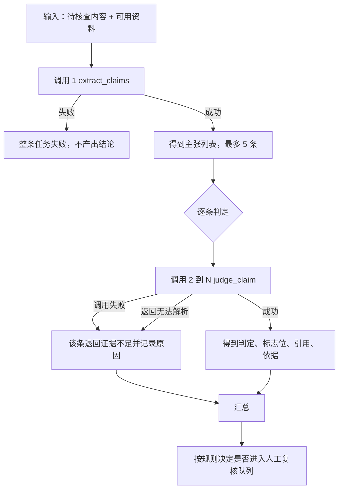

# v2 两段式管线快照

固化时间：2026-10-03

这个目录是「内容证据核查 Agent」v2 两段式管线的一个可还原快照，包含当时可执行的代码、配置、任务集，以及三次基线运行的结果。

## 先说清楚能还原什么

**能还原的**：代码逻辑、提示词、模型参数、任务集（30 条案例、35 条标注主张）、评分口径、基线结果。

**不能还原的**：逐位相同的运行结果。模型侧本身有噪声，在 `docs/06-reasoning-budget-experiment.md` 里量化过——同一配置连跑两遍，三条案例里有两条判定完全一致、只是理由措辞不同，一条出现结论翻转。所以重跑出来的指标会有一到两条案例的偏差，这是正常的，不代表还原失败。

要判断还原是否成功，看这三件事：`--validate-only` 输出的任务集指纹是不是 `6000dcf4`、27 个单元测试是否全过、离线桩基线的指标是否与下面记录的一致（桩是确定性的，必须完全一致）。

## 两段式管线是什么

v2 把一次任务拆成两种模型调用：



对比的 v1 只有一次调用，同时产出主张和判定。两者差别只在这一点，其余配置完全相同。

### 阶段一：抽取主张

系统提示词要求：只从待核查内容中提取主张，可用资料是判断证据而不是主张来源；数值和它的限定条件属于同一条主张；纯主观偏好和作者个人使用习惯不提取；最多 5 条，按对读者决策的影响排序。

输出契约：

```json
{"claims": [{"text": "澜声 Buds Pro 综合续航 40 小时", "claim_type": "numeric"}]}
```

`claim_type` 取值：`numeric`、`scope`、`exclusive`、`certification`、`health_safety`、`causal`、`timeline`、`other`。

### 阶段二：逐条判定

对阶段一产出的每一条主张单独发一次调用，上下文里只带这一条主张和全部资料。

输出契约：

```json
{
  "verdict": "SUPPORTED",
  "flags": ["OMITTED_CONDITION"],
  "evidence": ["S1"],
  "reasoning": "一句话说明依据"
}
```

`verdict` 四选一：`SUPPORTED` 支持、`PARTIAL` 部分支持、`CONTRADICTED` 冲突、`INSUFFICIENT` 证据不足。

`flags` 可多选：`STALE` 资料过期、`SOURCE_CONFLICT` 资料冲突、`SCOPE_MISMATCH` 范围错配、`OMITTED_CONDITION` 条件省略、`UNIT_MISMATCH` 单位不一致、`LOW_SOURCE_QUALITY` 来源质量低。

判定纪律写在提示词里，这几条是产品的核心约束：检索不到相关记录不等于反证，只能判证据不足；资料过期只让证据失效，不能据此判冲突，只有存在现版本反证时才判冲突；有效资料互相矛盾时判证据不足并标资料冲突，不要自行采信更权威的一方；仅营销或不可溯源来源不能支撑"支持"；数值容差正负 5%；范围型主张按最窄范围判定。

### 人工复核队列规则

由判定结果驱动，判断逻辑在 `src/evidence_agent/models.py` 的 `should_review()`：

- `CONTRADICTED` 和 `PARTIAL` 一律进队列
- 带 `STALE` 或 `SOURCE_CONFLICT` 标志的一律进队列
- `INSUFFICIENT` 只有在主张类型属于数值、认证、健康安全、排他这四类时才进队列

## 这个版本的四个确定要素

要还原一个版本，需要固定四样东西。任何一样变了，指标就不能直接对比。

| 要素 | 取值 |
|---|---|
| 任务集 | `data/eval_tasks.json`，30 条案例、35 条标注主张，指纹 `6000dcf4` |
| 模型 | `deepseek-flash`，接口 `https://api.deepseek.com/chat/completions` |
| 调用参数 | `temperature=0`、`max_tokens=3000`、JSON 输出模式、抽取和判定两个阶段都关闭思考模式 |
| 提示词 | `src/evidence_agent/prompts.py` 里的 `EXTRACT_SYSTEM` 和 `JUDGE_SYSTEM` |

## 失败与重试

每次模型调用的超时是 60 秒，最多重试 2 次，退避为 1.5 秒乘 2 的幂。空返回、限流、网络错误和服务端错误都会重试；鉴权失败和请求格式错误直接返回错误码，不重试。

任务级别的失败处理：

- 抽取阶段失败，整条任务标记失败，不产出任何结论
- 判定阶段调用失败，该条主张退回证据不足，并在依据里写明失败原因，其余主张正常跑完
- 判定结果无法解析，同样退回证据不足
- 单条任务抛出未预料的异常，该条标记失败，不中断整批评测

开跑前会先发一次极小的鉴权探测请求，如果是 401 或 403 就立刻中止，不会把整批任务撞一遍。

## 怎么还原

### 只验证，不调用模型

把 `source/` 里的目录复制回项目根目录，然后执行：

```powershell
cd 'D:\JOB\实习\content-evidence-agent'
python harness/run_eval.py --validate-only
python -m unittest discover -s tests -v
python harness/run_eval.py --adapter stub --pipeline v2
```

第一条要输出指纹 `6000dcf4` 和 30 条案例；第二条要 27 个测试全过；第三条不需要任何密钥，跑出来的指标必须与下面"离线桩基线"完全一致，因为桩是确定性的。

### 校验文件是否被改动过

`MANIFEST.json` 记录了当时每个文件的 SHA256。把清单里的 `sha256` 与当前文件比对，就能知道哪些文件被动过。`included` 为 `true` 的文件在 `source/` 下有副本，为 `false` 的（文档、运行报告等）只记录了哈希。

### 复现真实模型基线

```powershell
$env:DEEPSEEK_API_KEY = '你的密钥'
python harness/run_eval.py --config config/exp-judge-off.json --out runs/reproduced
python harness/compare_runs.py --base runs/final-judge-off --compare runs/reproduced
```

第二条命令会把复现结果和固化时的基线逐指标对照。指标应当接近，但不会完全相同，原因见开头关于噪声的说明。

## 基线结果

三次完整运行的原始产物都在 `baseline/` 下，包含评测报告、逐案例结果和运行配置快照。

### v2 两段式，两阶段都关闭思考（推荐配置）

| 指标 | 数值 |
|---|---|
| 主判定准确率 | 0.8857 |
| 主张召回率 | 1.0000 |
| 主张精确率 | 0.9722 |
| 标志位召回率 | 0.7241 |
| 无依据确定性结论率 | 0.0000 |
| 复核队列一致率 | 0.9429 |
| P0 与 P1 错误 | 0 与 11 |
| 模型调用 | 66 次 |
| 输入与输出 token | 34,866 与 3,502 |
| 平均单任务耗时 | 2,657 ms |
| 30 条成本 | 0.0489 元 |

### v2 两段式，判定阶段开启低强度思考

主判定准确率 0.8000，P0 为 1，无依据确定性结论率 0.0833，输出 token 30,266，平均耗时 6,521 ms，成本 0.1574 元。

### v1 单次调用

主判定准确率 0.7429，P0 为 1，模型调用 30 次，平均耗时 1,561 ms，成本 0.0362 元。

### 离线桩基线

这一组是在本快照的任务集上跑出来的，复原时应当与之完全一致，可用于验证还原是否成功。

| 指标 | 数值 |
|---|---|
| 主判定准确率 | 0.267 |
| 主张召回率 | 0.857 |
| 主张精确率 | 1.000 |
| 标志位召回率 | 0.000 |
| 无依据确定性结论率 | 1.000 |
| 复核队列一致率 | 0.333 |
| P0 与 P1 错误 | 19 与 23 |
| 模型调用 | 60 次 |
| 平均单任务耗时 | 0 ms（桩不发起网络请求） |

桩被设计成对任何主张都答"支持"，所以它的无依据确定性结论率必然是 1.0、标志位召回率必然是 0。这组数字的作用是证明指标能把过度自信的系统分辨出来，不代表模型能力。它同时是唯一一组可逐位复现的基准，因为桩不依赖网络。

## 快照内容

```
snapshots/v2-two-stage-20261003/
├── README.md          本文件
├── MANIFEST.json      文件清单与哈希
├── source/            当时的代码
│   ├── src/           评测核心与模型适配器
│   ├── harness/       命令行入口
│   ├── config/        运行配置
│   ├── data/          任务集
│   ├── tests/         单元测试
│   ├── app/           Web 工作台
│   └── docs/          场景定义、标注规则与实验记录
└── baseline/          三次基线运行的原始产物
```

`docs/` 放进来是因为标注规则和场景定义属于这个版本的一部分——提示词就是照着 `02-labeling-rules.md` 写的。没有规则文档，光有代码无法判断某个判定为什么该那样判。

## 已知限制

**这个版本没有真正的工具调用。** 资料是直接拼进提示词的，模型不能按需检索或定向取段落。要让核查流程更接近真正的 Agent，需要加工具层和失败后的重规划。

**引用命中率是近似指标。** 它比较的是引用编号与标注是否一致，不能判断被引用的那段文字是否真的支撑结论。

**复核队列的标注来自规则推导。** 队列是否进入是按规则算的，不是独立的人工判断，所以这项指标衡量的是规则有没有被正确执行，不是规则本身对不对。

**评测集有噪声下限。** 一到两条案例的差异属于噪声，判断改动是否有效要看多条案例是否朝同一方向变化。
